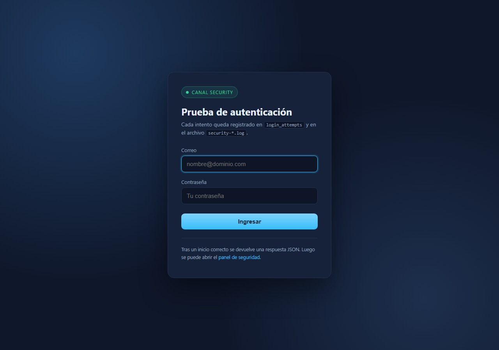
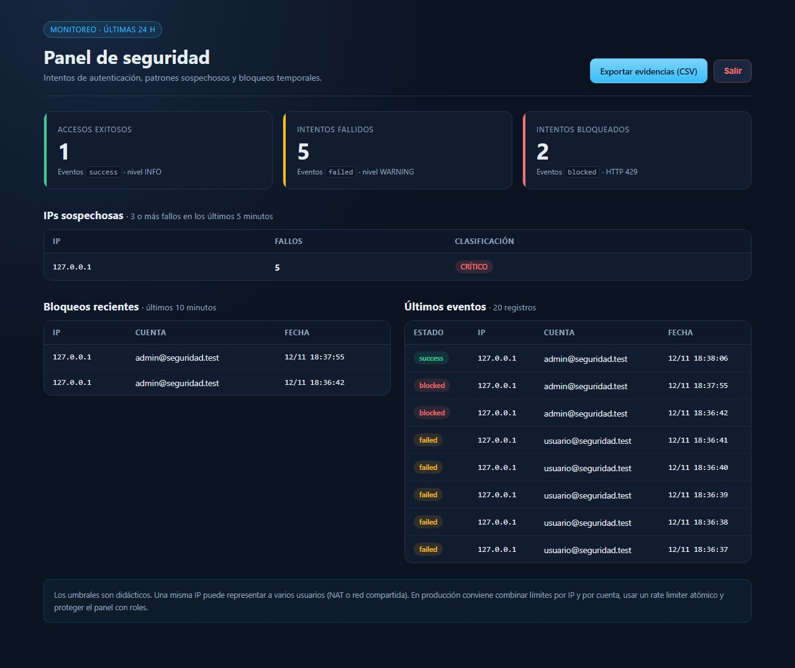
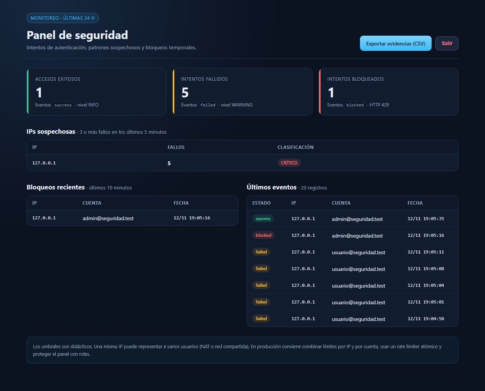

# Logging y detección de incidentes de seguridad

Registro de intentos de autenticación, detección de patrones sospechosos, bloqueo temporal automático y panel de monitoreo, implementado en **Laravel 13** sobre **SQLite**.

**Repositorio:** https://github.com/liabarcos/seguridad-logs

---

## Índice

1. [Qué hace](#-qué-hace)
2. [Stack](#-stack)
3. [Arquitectura](#-arquitectura)
4. [Instalación](#-instalación)
5. [Usuarios de prueba](#-usuarios-de-prueba)
6. [Configuración](#️-configuración)
7. [Reglas de detección](#-reglas-de-detección)
8. [Cómo funciona el controlador](#-cómo-funciona-el-controlador)
9. [Panel de seguridad](#-panel-de-seguridad)
10. [Base de datos y consultas](#️-base-de-datos-y-consultas)
11. [Pruebas](#-pruebas)
12. [Capturas](#-capturas)
13. [Verificación manual](#-verificación-manual)
14. [Análisis y conclusiones](#-análisis-y-conclusiones)
15. [Mejoras implementadas](#-mejoras-implementadas)
16. [Seguridad y límites](#️-seguridad-y-límites)
17. [Estructura del proyecto](#-estructura-del-proyecto)
18. [Solución de problemas](#-solución-de-problemas)

---

## 🎯 Qué hace

- Registra **cada intento de inicio de sesión** en la tabla `login_attempts`, separado del log técnico de la aplicación.
- Clasifica los fallos por IP dentro de una **ventana de 5 minutos**:
  - 1–2 fallos → `WARNING`
  - 3–4 fallos → `ALERT`
  - 5 fallos → `CRITICAL` y **bloqueo temporal de 10 minutos**
- Responde **HTTP 429** mientras la IP está bloqueada y registra el evento `blocked`.
- Registra los accesos correctos como `success` con nivel `INFO`.
- Ofrece un **panel de monitoreo** protegido por un Gate con contadores, IPs sospechosas, bloqueos recientes y últimos eventos.
- Permite **exportar las evidencias a CSV**.
- Incluye una **detección complementaria por cuenta**, para advertir fallos distribuidos desde varias IP.

---

## 🧰 Stack

| Componente | Versión / detalle |
|---|---|
| PHP | 8.3.36 |
| Laravel | 13.42.0 |
| Base de datos | SQLite |
| Vistas | Blade con CSS embebido (no requiere Vite ni npm) |
| Pruebas | PHPUnit 12.5 |
| Caché | Driver `database` (persistente entre peticiones) |
| Logs | Canal `security` con driver `daily` y retención de 30 días |

---

## 🏗 Arquitectura

```text
POST /security-login
        │
        ▼
SecurityLoginController
        │
        ├──► Cache::has('security:block:' . sha256(ip))
        │         │
        │         └── si existe ──► LoginAttempt(status=blocked) + HTTP 429
        │
        ├──► Auth::attempt(...)
        │         │
        │         ├── correcto ──► LoginAttempt(status=success)
        │         │                 Log::channel('security')->info(...)
        │         │                 HTTP 200
        │         │
        │         └── incorrecto ──► LoginAttempt(status=failed)
        │                            cuenta los fallos de la IP en 5 min
        │                            WARNING / ALERT / CRITICAL
        │                            HTTP 401
        │
        ▼
storage/logs/security-AAAA-MM-DD.log   +   tabla login_attempts

GET /security-dashboard
        │
        ▼
Gate viewSecurityDashboard (solo administradores)
        │
        ▼
SecurityDashboardController
        ├── contadores de las últimas 24 h
        ├── IPs con 3 o más fallos en 5 minutos
        ├── bloqueos de los últimos 10 minutos
        └── últimos 20 eventos
```

La idea central es **separar dos registros**:

- **`login_attempts`**: auditoría consultable, con IP, cuenta, estado, user agent y fecha.
- **`security-AAAA-MM-DD.log`**: evidencia técnica con niveles de severidad, útil para alertas y herramientas de monitoreo.

---

## 🚀 Instalación

Requisitos: PHP 8.3 o superior, Composer y la extensión `pdo_sqlite`.

```powershell
composer install
Copy-Item .env.example .env
php artisan key:generate
```

Crear la base si no existe:

```powershell
New-Item database/database.sqlite -ItemType File
```

Migrar y cargar los usuarios de prueba:

```powershell
php artisan migrate --seed
php artisan config:clear
php artisan serve
```

Abrir `http://127.0.0.1:8000/security-login`.

> En Linux/macOS el único cambio es `touch database/database.sqlite` y `cp .env.example .env`.

---

## 👥 Usuarios de prueba

El seeder crea dos cuentas:

| Correo | Contraseña | Rol | Acceso al panel |
|---|---|---|---|
| `admin@seguridad.test` | `password` | Administrador | Sí |
| `analista@seguridad.test` | `password` | Analista | No (HTTP 403) |

El rol se guarda en la columna `is_admin` de la tabla `users`.

---

## ⚙️ Configuración

### `.env`

| Variable | Valor | Para qué |
|---|---|---|
| `APP_DEBUG` | `true` | Desarrollo. En producción debe ser `false`. |
| `LOG_CHANNEL` | `daily` | Log técnico general con rotación diaria. |
| `LOG_LEVEL` | `debug` | Nivel del log general. |
| `CACHE_STORE` | `database` | El bloqueo sobrevive entre peticiones y procesos. |
| `DB_CONNECTION` | `sqlite` | Base portable, sin servidor externo. |

### Canal `security`

Definido en `config/logging.php`:

```php
'security' => [
    'driver' => 'daily',
    'path' => storage_path('logs/security.log'),
    'level' => 'info',
    'days' => 30,
],
```

El nivel `info` deja pasar `info`, `warning`, `alert` y `critical`. Los eventos se escriben en `storage/logs/security-AAAA-MM-DD.log` y se conservan **30 días**.

Después de cambiar configuración:

```powershell
php artisan config:clear
```

---

## 🧭 Reglas de detección

| Condición | Estado en base | Nivel de log | Respuesta HTTP |
|---|---|---|---|
| 1–2 fallos en 5 minutos | `failed` | `WARNING` | `401` |
| 3–4 fallos en 5 minutos | `failed` | `ALERT` | `401` |
| 5.º fallo en 5 minutos | `failed` | `CRITICAL` + bloqueo 10 min | `401` |
| IP bloqueada | `blocked` | `WARNING` | `429` |
| Autenticación correcta | `success` | `INFO` | `200` |
| Credenciales inválidas | `failed` | según el conteo | `401` |

> **Importante:** el quinto intento fallido **todavía responde 401**, porque en esa misma petición se evalúan las credenciales y se activa el bloqueo. El **siguiente** intento ya recibe `429`. Así funciona el código de referencia del enunciado.

La clave de caché es:

```php
'security:block:' . hash('sha256', $ip)
```

Se usa SHA-256 para no guardar la IP en texto plano dentro de la clave de caché. El bloqueo se guarda con `Cache::put($key, true, now()->addMinutes(10))`.

---

## 🔐 Cómo funciona el controlador

`app/Http/Controllers/SecurityLoginController.php` sigue este orden:

1. **Valida** `email` y `password` (`required|email`, `required|string`).
2. Calcula la IP y la clave de bloqueo.
3. Si la IP está bloqueada:
   - guarda `blocked`,
   - escribe `WARNING` con el mensaje `Intento desde IP bloqueada`,
   - devuelve `429` con `Acceso temporalmente restringido.`
4. Si las credenciales son correctas:
   - regenera la sesión (evita fijación de sesión),
   - guarda `success`,
   - escribe `INFO` con `user_id` e IP,
   - devuelve `200` con `Autenticación correcta`.
5. Si las credenciales son incorrectas:
   - guarda `failed`,
   - cuenta los fallos de esa IP en los últimos 5 minutos,
   - escribe `WARNING` con el acumulado,
   - en el umbral 3 escribe `ALERT`,
   - en el umbral 5 escribe `CRITICAL` y activa el bloqueo,
   - devuelve `401` con `Credenciales inválidas`.
6. Ejecuta la **detección por cuenta** (mejora explicada más abajo).

El registro se centraliza en `record()`:

```php
LoginAttempt::create([
    'identifier' => mb_strtolower((string) $request->input('email', '')),
    'ip_address' => $request->ip(),
    'status' => $status,
    'user_agent' => substr((string) ($request->userAgent() ?? ''), 0, 255),
    'created_at' => now(),
]);
```

El modelo `LoginAttempt` tiene `public $timestamps = false`, porque la tabla solo guarda `created_at` y no usa `updated_at`.

---

## 📊 Panel de seguridad

Ruta: `GET /security-dashboard`

Protección:

```php
Route::get('/security-dashboard', [SecurityDashboardController::class, 'index'])
    ->middleware(['auth', 'can:viewSecurityDashboard']);
```

El Gate se define en `AppServiceProvider`:

```php
Gate::define('viewSecurityDashboard', fn (User $user) => $user->is_admin);
```

El panel muestra:

- **Contadores de las últimas 24 horas:** exitosos, fallidos y bloqueados.
- **IPs sospechosas:** 3 o más fallos en los últimos 5 minutos, con clasificación `ALERTA` o `CRÍTICO`.
- **Bloqueos recientes:** eventos `blocked` de los últimos 10 minutos.
- **Últimos 20 eventos:** estado, IP, cuenta y fecha.
- **Exportación CSV:** botón `Exportar evidencias (CSV)`, también protegido por el Gate.

La exportación usa `response()->streamDownload()` y limita a los **1000 registros más recientes** para no generar archivos enormes durante una demostración.

Rutas disponibles:

| Método | Ruta | Descripción |
|---|---|---|
| `GET` | `/` | Redirige al login. |
| `GET` | `/security-login` | Formulario de prueba. |
| `POST` | `/security-login` | Procesa el intento. |
| `GET` | `/security-dashboard` | Panel (solo administradores). |
| `GET` | `/security-dashboard/export` | Evidencias en CSV (solo administradores). |
| `POST` | `/logout` | Cierra la sesión. |

---

## 🗄️ Base de datos y consultas

### Tabla `login_attempts`

| Columna | Tipo | Detalle |
|---|---|---|
| `id` | entero | Clave primaria. |
| `identifier` | string, nullable | Correo normalizado a minúsculas. |
| `ip_address` | string(45) | Admite IPv4 e IPv6. |
| `status` | string(20) | `success`, `failed` o `blocked`. |
| `user_agent` | string, nullable | Recortado a 255 caracteres. |
| `created_at` | timestamp | Valor por defecto: `CURRENT_TIMESTAMP`. |

Índices:

- `['ip_address', 'status', 'created_at']` → consulta principal de fallos por IP.
- `['identifier', 'status', 'created_at']` → detección por cuenta (mejora).

### Consultas útiles

Últimos 20 eventos:

```sql
SELECT * FROM login_attempts
ORDER BY created_at DESC
LIMIT 20;
```

Fallos acumulados por IP:

```sql
SELECT ip_address, COUNT(*) AS total_fallos
FROM login_attempts
WHERE status = 'failed'
GROUP BY ip_address
ORDER BY total_fallos DESC;
```

IPs sospechosas en los últimos 5 minutos (SQLite):

```sql
SELECT ip_address, COUNT(*) AS total_fallos
FROM login_attempts
WHERE status = 'failed'
  AND created_at >= datetime('now', '-5 minutes')
GROUP BY ip_address
HAVING COUNT(*) >= 3;
```

La misma consulta para MySQL:

```sql
SELECT ip_address, COUNT(*) AS total_fallos
FROM login_attempts
WHERE status = 'failed'
  AND created_at >= NOW() - INTERVAL 5 MINUTE
GROUP BY ip_address
HAVING COUNT(*) >= 3;
```

Fallos por cuenta (mejora):

```sql
SELECT identifier, COUNT(*) AS total_fallos
FROM login_attempts
WHERE status = 'failed'
  AND created_at >= datetime('now', '-5 minutes')
GROUP BY identifier
HAVING COUNT(*) >= 3;
```

También se puede consultar desde Laravel:

```powershell
php artisan tinker
```

```php
App\Models\LoginAttempt::latest('created_at')->limit(20)->get();
```

---

## 🧪 Pruebas

```powershell
php artisan test
```

Resultado:

```text
Tests:    14 passed (68 assertions)
```

Las pruebas usan SQLite en memoria, caché `array` y `Log::spy()`, por lo que **no modifican la base de desarrollo ni escriben en el log real**.

### Cobertura de los escenarios obligatorios

| Escenario | Prueba | Resultado verificado |
|---|---|---|
| Login válido | `test_login_valido_registra_success_y_log_info` | `INFO`, `success`, HTTP 200 |
| Dos contraseñas incorrectas | `test_dos_fallos_generan_warning` | Dos `WARNING`, dos `failed`, HTTP 401 |
| Tres fallos en 5 minutos | `test_tres_fallos_generan_alert` | `ALERT` por fuerza bruta |
| Cinco fallos en 5 minutos | `test_cinco_fallos_bloquean_diez_minutos_y_generan_critical` | `CRITICAL`, bloqueo de 10 min |
| Acceso con IP bloqueada | `test_ip_bloqueada_responde_429_y_registra_blocked` | HTTP 429, evento `blocked` |
| Acceso tras vencer el bloqueo | `test_acceso_tras_vencer_el_bloqueo` | Login habilitado otra vez |
| Detección por cuenta | `test_detecta_fallos_por_cuenta_desde_varias_ips` | `ALERT` desde 3 IP distintas |
| Panel sin sesión | `test_dashboard_requiere_autenticacion` | Redirección al login |
| Panel sin permiso | `test_dashboard_rechaza_usuario_sin_permiso` | HTTP 403 |
| Panel con permiso | `test_dashboard_muestra_metricas_ips_sospechosas_y_eventos` | Métricas, IP y `CRÍTICO` |
| Exportación | `test_exporta_evidencias_en_csv` | CSV con encabezados y datos |
| Canal configurado | `test_canal_security_esta_configurado` | `daily`, `info`, 30 días |

Además, `tests/Feature/ExampleTest.php` verifica que `/` redirige al login.

### Reiniciar el estado entre escenarios manuales

```powershell
php artisan cache:clear
php artisan migrate:fresh --seed
```

- `cache:clear` elimina los bloqueos activos.
- `migrate:fresh --seed` deja la base y los usuarios como al inicio.

---

## 📸 Capturas

### Formulario de acceso



### Panel de seguridad



### Panel con intentos fallidos y bloqueos

Evidencia generada después de cinco fallos consecutivos y un intento desde la IP bloqueada: el panel muestra `5` eventos `failed`, `1` evento `blocked`, la IP `127.0.0.1` clasificada como **CRÍTICO** y el detalle de los últimos eventos.



---

## 🔎 Verificación manual

Con el servidor en `http://127.0.0.1:8000`:

1. Abrir `/security-login` y equivocarse cinco veces con la misma cuenta.
2. El sexto intento, incluso con la contraseña correcta, responde:

```http
HTTP/1.1 429 Too Many Requests
Content-Type: application/json

{"message":"Acceso temporalmente restringido."}
```

3. El log del canal `security` queda así:

```text
[2026-11-12 18:36:37] local.WARNING: Autenticación fallida {"ip":"127.0.0.1","failed_attempts":1}
[2026-11-12 18:36:38] local.WARNING: Autenticación fallida {"ip":"127.0.0.1","failed_attempts":2}
[2026-11-12 18:36:39] local.WARNING: Autenticación fallida {"ip":"127.0.0.1","failed_attempts":3}
[2026-11-12 18:36:39] local.ALERT: Posible ataque de fuerza bruta {"ip":"127.0.0.1","failed_attempts":3}
[2026-11-12 18:36:40] local.WARNING: Autenticación fallida {"ip":"127.0.0.1","failed_attempts":4}
[2026-11-12 18:36:40] local.ALERT: Posible ataque de fuerza bruta {"ip":"127.0.0.1","failed_attempts":4}
[2026-11-12 18:36:41] local.WARNING: Autenticación fallida {"ip":"127.0.0.1","failed_attempts":5}
[2026-11-12 18:36:41] local.CRITICAL: Bloqueo temporal por intentos fallidos {"ip":"127.0.0.1","failed_attempts":5,"duration_minutes":10}
[2026-11-12 18:36:42] local.WARNING: Intento desde IP bloqueada {"ip":"127.0.0.1"}
```

4. Ver los registros en la base:

```powershell
php artisan tinker --execute="App\Models\LoginAttempt::latest('created_at')->limit(10)->get(['ip_address','identifier','status','created_at']);"
```

5. Desbloquear para seguir probando:

```powershell
php artisan cache:clear
```

---

## 🧠 Análisis y conclusiones

### ¿Qué IP concentra los fallos?

En la demostración local, **`127.0.0.1`** concentró los cinco fallos dentro de la ventana de cinco minutos. Es la dirección de loopback: todas las pruebas se hicieron desde la misma máquina. En un entorno real se vería la IP pública o la IP del proxy, y conviene revisar si hay varias cuentas detrás de ella.

### ¿Puede afirmarse que existe un ataque?

**No con esos datos por sí solos.** Cinco fallos pueden ser un usuario legítimo que se equivoca de contraseña, una aplicación mal configurada o una prueba automatizada. Para hablar de ataque hacen falta más señales:

- muchos identificadores distintos atacados desde la misma IP;
- un mismo identificador atacado desde muchas IP;
- intervalos regulares o velocidad incompatible con una persona;
- `user_agent` repetitivo o vacío;
- intentos que continúan después de un bloqueo;
- correlación con otros servicios, WAF o logs del servidor.

La evidencia permite afirmar **actividad sospechosa**, no necesariamente una intrusión.

### ¿Qué efectos tendría bloquear una IP compartida?

Una IP puede representar a **toda una oficina, un campus o una red NAT**. Bloquearla afecta a usuarios legítimos que comparten salida y puede convertirse en una **denegación de servicio accidental**. Por eso el bloqueo por IP debe combinarse con:

- límites por cuenta;
- demoras progresivas;
- CAPTCHA o verificación adicional;
- notificación al usuario;
- revisión humana antes de bloqueos largos.

### ¿Qué evidencias adicionales se necesitan?

- `identifier` completo y si la cuenta existe;
- `user_agent` y huellas de dispositivo;
- horarios exactos y regularidad de los intentos;
- resultado posterior (¿hubo un `success` después de los fallos?);
- distribución geográfica o ASN de la IP;
- logs del servidor web, WAF, VPN o proxy;
- acciones administrativas y cambios de permisos;
- historial de incidentes anteriores.

### ¿Qué respuestas conviene automatizar?

- **Bloqueo temporal** con vencimiento (implementado: 10 minutos).
- **Alertas** ante `ALERT` y `CRITICAL` (implementado en el canal `security`).
- **Detección por cuenta** además de por IP (implementado).
- **Exportación de evidencias** para análisis posterior (implementado).
- Rate limiting atómico, notificaciones por correo o SIEM, bloqueo de cuenta y MFA en un entorno real.

---

## ✨ Mejoras implementadas

### 1. Detección por cuenta

Además del umbral por IP, el controlador cuenta los fallos del mismo `identifier` en los últimos cinco minutos. Si hay **3 o más fallos sobre la misma cuenta** y la IP todavía no llegó a 3, se registra:

```text
ALERT: Fallos repetidos sobre una misma cuenta
```

Esto permite detectar un ataque distribuido desde varias IP, que el límite por IP aislado no vería.

### 2. Exportación de evidencias en CSV

`GET /security-dashboard/export` descarga un CSV con:

```text
id, identifier, ip_address, status, user_agent, created_at
```

Está protegido por el mismo Gate que el panel y limita la exportación a los 1000 registros más recientes.

### Mejoras menores

- Roles con `is_admin` y Gate `viewSecurityDashboard`.
- Cierre de sesión con invalidación de sesión y regeneración del token CSRF.
- Redirecciones correctas para usuarios autenticados y visitantes.
- Panel con clasificación visual `ALERTA` / `CRÍTICO` y estados con color.

---

## 🛡️ Seguridad y límites

Este proyecto es **educativo**. Los umbrales son didácticos y no reemplazan una solución de producción.

Limitaciones conocidas:

- **La comprobación de caché no es atómica.** Dos peticiones simultáneas podrían pasar antes de que se guarde el bloqueo. En producción se usaría `RateLimiter` con Redis y operaciones atómicas.
- **El bloqueo es solo por IP.** Una IP compartida puede afectar a varios usuarios. La detección por cuenta ayuda, pero no reemplaza una política combinada.
- **La IP puede no ser la real** si hay un proxy mal configurado. Hay que definir `TrustProxies` correctamente.
- **El user agent es un dato controlado por el cliente** y puede falsificarse.
- **Los logs no son una auditoría íntegra.** Pueden rotar, borrarse o alterarse; para evidencia forense se necesita almacenamiento protegido e inmutable.
- **Se guardan datos personales** (correo, IP, user agent). En producción corresponde aplicar minimización, retención y acceso restringido.
- **La caché `database` es suficiente para la práctica**, pero Redis es más adecuada para alta concurrencia.
- **El panel está protegido por rol**, pero en producción conviene agregar MFA, auditoría de accesos al panel y HTTPS.

Recomendaciones para producción:

1. `APP_DEBUG=false`.
2. HTTPS obligatorio.
3. Rate limiting atómico por IP y por cuenta.
4. Notificaciones a SIEM o correo ante `CRITICAL`.
5. Retención y protección de logs.
6. Revisión periódica de IPs bloqueadas.
7. Contraseñas con hash fuerte y MFA.
8. Monitoreo de accesos al propio panel.

---

## 📁 Estructura del proyecto

```text
seguridad-logs/
├── app/
│   ├── Http/Controllers/
│   │   ├── SecurityLoginController.php
│   │   └── SecurityDashboardController.php
│   ├── Models/
│   │   ├── LoginAttempt.php
│   │   └── User.php
│   └── Providers/AppServiceProvider.php   # Gate viewSecurityDashboard
├── bootstrap/app.php                      # redirecciones de auth
├── config/logging.php                     # canal security
├── database/
│   ├── migrations/
│   │   ├── 0001_01_01_000000_create_users_table.php
│   │   └── 2026_11_12_180000_create_login_attempts_table.php
│   └── seeders/DatabaseSeeder.php
├── docs/capturas/
│   ├── security-login.jpeg
│   ├── security-dashboard.jpeg
│   └── security-dashboard-eventos.jpeg
├── resources/views/
│   ├── security-login.blade.php
│   └── security-dashboard.blade.php
├── routes/web.php
└── tests/Feature/
    ├── SecurityLoginTest.php
    └── ExampleTest.php
```

---

## 🧯 Solución de problemas

| Síntoma | Causa probable | Solución |
|---|---|---|
| `419 Page Expired` | Token CSRF o sesión vencida. | Recargar el formulario y volver a enviar. |
| El login redirige en bucle | Usuario autenticado visitando `/security-login`. | Ya está resuelto con `redirectUsersTo('/security-dashboard')` en `bootstrap/app.php`. |
| `403` en el panel | El usuario no es administrador. | Usar `admin@seguridad.test` o marcar `is_admin = 1`. |
| `429` durante la demostración | La IP tiene un bloqueo activo. | `php artisan cache:clear` para reiniciar el estado. |
| El panel está vacío | No hay eventos registrados. | Generar intentos desde `/security-login`. |
| No aparece el archivo de log | Configuración cacheada o permisos. | `php artisan config:clear` y revisar permisos de `storage/logs`. |
| `Database file does not exist` | Falta `database/database.sqlite`. | Crear el archivo y ejecutar `php artisan migrate --seed`. |
| El puerto 8000 está ocupado | Otro servidor está escuchando. | `php artisan serve --port=8001` y actualizar `APP_URL`. |
| Los cambios en `.env` no se aplican | Configuración cacheada. | `php artisan optimize:clear`. |

---

## 👤 Autor

**liabarcos** — [github.com/liabarcos](https://github.com/liabarcos)

Trabajo práctico de **Programación Backend / Seguridad Informática**.
